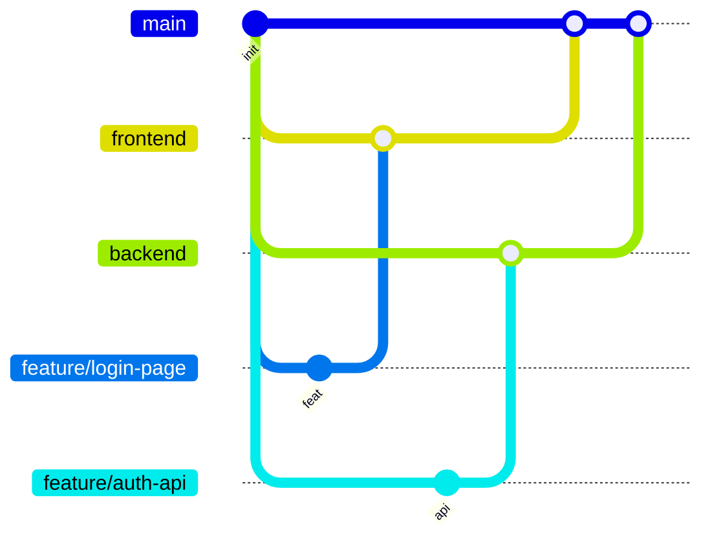

# 🌿 Правила работы с Git и процесс слияния изменений

> Единый порядок разработки: от рабочей ветки до интеграции Frontend и Backend в `main`.

---

## 📑 Содержание

1. [Структура веток](#-структура-веток)
2. [Процесс разработки](#-процесс-разработки)
3. [Отправка изменений](#-отправка-изменений)
4. [Создание Pull Request](#-создание-pull-request)
5. [Проверка и слияние в основные ветки](#-проверка-и-слияние-в-основные-ветки)
6. [Слияние в main](#-слияние-в-main)
7. [Основные правила](#-основные-правила)

---

## 🌳 Структура веток

В проекте используются три основные ветки:

| Ветка | Назначение |
|-------|------------|
| 🟢 `main` | Основная ветка проекта. Содержит общую версию Frontend и Backend, используется для проверки их совместной работы |
| 🔵 `frontend` | Основная ветка разработки клиентской части |
| 🟠 `backend` | Основная ветка разработки серверной части |

> [!IMPORTANT]
> Разработчикам **запрещено** напрямую вносить изменения в основные ветки.
> Все изменения должны проходить через **Pull Request**.



---

## 🛠 Процесс разработки

Каждый разработчик работает в своей области:

- 🎨 **Frontend-разработчики** → ветка `frontend`
- ⚙️ **Backend-разработчики** → ветка `backend`

Для каждой новой задачи создаётся **отдельная рабочая ветка** от соответствующей основной ветки.

### 🏷 Примеры названий веток

| Префикс | Пример |
|---------|--------|
| `feature/` | `feature/login-page` |
| `feature/` | `feature/user-profile` |
| `feature/` | `feature/auth-api` |
| `fix/` | `fix/login-error` |

### ➕ Создание рабочей ветки

**Frontend:**

```bash
git switch frontend
git pull origin frontend
git switch -c feature/название-задачи
```

**Backend:**

```bash
git switch backend
git pull origin backend
git switch -c feature/название-задачи
```

---

## 🚀 Отправка изменений

После завершения задачи разработчик должен:

- [ ] Проверить работоспособность внесённых изменений
- [ ] Выполнить необходимые тесты
- [ ] Зафиксировать изменения с помощью `commit`
- [ ] Отправить рабочую ветку в удалённый репозиторий

```bash
git add .
git commit -m "Описание изменений"
git push -u origin feature/название-задачи
```

---

## 🔀 Создание Pull Request

После отправки изменений разработчик создаёт Pull Request на GitHub.

> [!WARNING]
> **Как создать PR правильно**

Пример: разработчик закончил задачу на фронтенде.

1. Открыть вкладку **Pull requests**
2. Нажать **New pull request**
3. В поле **base** выбрать `frontend`
4. В поле **compare** выбрать свою рабочую ветку, например `feature/login`
5. Нажать **Create pull request**

### 🎯 Целевые ветки

| Часть проекта | Откуда | Куда |
|---------------|:------:|:----:|
| 🎨 Frontend | `feature/*` | ➜ `frontend` |
| ⚙️ Backend | `feature/*` | ➜ `backend` |

### 📝 Что указать в описании PR

- Что было реализовано или исправлено
- Какие файлы и функциональность затронуты
- Какие проверки и тесты были выполнены

---

## ✅ Проверка и слияние в основные ветки

После создания Pull Request ответственный за соответствующую часть проекта проверяет изменения.

| Результат проверки | Действие |
|--------------------|----------|
| ✔️ Изменения соответствуют требованиям, критических ошибок нет | PR одобряется и объединяется с `frontend` или `backend` |
| ❌ Обнаружены ошибки или недочёты | PR возвращается на доработку с указанием исправлений |

---

## 🧩 Слияние в main

Ветка `main` — общая **интеграционная** ветка проекта.

После завершения и проверки изменений Frontend и Backend ответственный за проект создаёт Pull Request:

| Откуда | Куда | Папка в `main` |
|--------|------|----------------|
| `frontend` | `main` | 📁 `frontend/` |
| `backend` | `main` | 📁 `backend/` |

> [!CAUTION]
> Слияние в `main` разрешается **исключительно** после проверки и одобрения владельцем проекта.

После объединения проводится **совместное тестирование** Frontend и Backend.
Если обнаружены проблемы интеграции — исправить их в соответствующих рабочих ветках и повторно пройти процедуру Pull Request.

### 🔧 Как мерджить основные ветки разработчиков в main

**1. Обновить `main`:**

```bash
git switch main
git pull origin main
```

**2. Создать временную интеграционную ветку:**

```bash
git switch -c integration/frontend
```

**3. Поместить содержимое ветки `frontend` в папку `frontend`:**

```bash
mkdir frontend
git archive frontend | tar -x -C frontend
```

> 💡 Команда берёт содержимое ветки `frontend` и распаковывает его в папку `frontend` текущей ветки.

**4. Закоммитить и отправить:**

```bash
git add .
git commit -m "Integrate frontend into main"
git push -u origin integration/frontend
```

**5. Создать PR на GitHub:** `integration/frontend` ➜ `main`

> Для `backend` порядок аналогичный (`integration/backend`, папка `backend`).

---

## 📌 Основные правила

1. 🚫 Запрещено напрямую отправлять изменения в `main`, `frontend` и `backend`
2. 🌱 Каждая задача выполняется в отдельной рабочей ветке
3. 🔀 Все изменения проходят через Pull Request
4. 🧪 Перед созданием PR необходимо проверить работоспособность своего кода
5. 📝 Разработчик обязан описывать внесённые изменения в Pull Request
6. 👑 Только владелец проекта имеет право одобрять и объединять PR в `main`
7. ⛔ Нельзя самостоятельно объединять изменения в `main` без разрешения владельца проекта
8. 🧹 После завершения задачи рабочую ветку рекомендуется удалить

---

<p align="center">
  <sub>Git Workflow · Frontend / Backend / main</sub>
</p>
